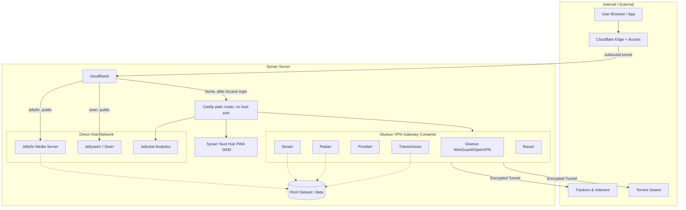

# ⚡ Synarr

<p align="center">
  <strong>The Turnkey, VPN-Secured <code>*arr</code> & Media Streaming Suite with Unified Authentication Hub</strong>
</p>

<p align="center">
  
  
  
  
  
</p>

---

**Synarr** is a production-ready, fully automated, self-hosted media center. It brings together the complete **Servarr** ecosystem (`Radarr`, `Sonarr`, `Prowlarr`, `Bazarr`, `Overseerr/Seerr`), a torrent client (`Transmission`), an analytics engine (`Jellystat`), and a streaming server (`Jellyfin`), reachable from anywhere through a **Cloudflare Tunnel** (no router port), with the admin tools behind one **Cloudflare Access** login and a Nuxt PWA hub, and secured via a **Gluetun VPN Sidecar**.

---

## 🏗️ Architecture



### Key Highlights

* 🛡️ **Sidecar VPN Gateway**: All acquisition and indexer containers share the network stack of Gluetun (`network_mode: "container:vpn"`). If the VPN drops, all torrent/search traffic immediately halts (built-in killswitch).
* 🔐 **One login, no open port**: A Cloudflare Tunnel is the only way in from the internet. `home.<domain>` (hub and every admin tool) sits behind one Cloudflare Access login for the owner only; Caddy refuses any request that did not pass Access. Jellyfin and Seerr are public with their own Jellyfin accounts, so the TV and phone apps work.
* ⚡ **Atomic Hardlinks**: A unified single-root dataset (`/data`) allows instant, zero-duplicate moves between downloading (`torrents/`) and your organized streaming library (`media/`).
* 📱 **Progressive Web App (PWA)**: Access and switch between all services on desktop or mobile through the unified Synarr interface.

---

## 🧩 Included Services

| Service | Role | Network Mode |
| :--- | :--- | :--- |
| **Gluetun** | VPN gateway & encrypted killswitch tunnel | Direct (Exposes web ports) |
| **Transmission** | BitTorrent downloader | Routed via VPN sidecar |
| **Prowlarr** | Torrent indexer & tracker manager | Routed via VPN sidecar |
| **Radarr** | Movie library automation & manager | Routed via VPN sidecar |
| **Sonarr** | TV show series automation & manager | Routed via VPN sidecar |
| **Bazarr** | Subtitle downloader & manager | Routed via VPN sidecar |
| **Seerr** | Media discovery & request manager | Host / Direct |
| **Jellyfin** | Personal media player & streaming server | Host / Direct |
| **Jellystat** | Jellyfin analytics & watch statistics | Host / Direct |
| **Synarr Hub** | Dashboard and module launcher (PWA) | Behind Caddy |
| **Caddy** | Path router for `home.<domain>`, no host port | Behind cloudflared |
| **cloudflared** | Cloudflare Tunnel connector (outbound only) | Compose network |

---

## 📂 Storage Structure & Hardlinks

To avoid wasting disk space and eliminate slow file copies across filesystems, Synarr uses a **Single Root Dataset** (`/data`):

```text
data/
├── torrents/                  # In-progress & seeding files
│   ├── movies/
│   └── tv/
└── media/                     # Formatted library (Jellyfin source)
    ├── movies/
    └── tv/
docker-config/                 # Persistent service configurations
    ├── vpn/
    ├── transmission/
    ├── radarr/
    ├── sonarr/
    ├── prowlarr/
    ├── bazarr/
    ├── seerr/
    └── hub/
```

> [!TIP]
> Because `./data` is mounted to `/data` across all containers, Radarr and Sonarr create **hardlinks** from `torrents/` to `media/`. Files remain seeding without taking twice the disk space.

---

## 🚀 Quick Start

### 1. Clone the repository

```bash
git clone https://github.com/<your-username>/synarr.git
cd synarr
```

### 2. Prepare directories

Create required persistent data and configuration directories:

```bash
chmod +x ./bin/create-folder-structure.sh
./bin/create-folder-structure.sh
```

### 3. Configure your VPN

Place your OpenVPN (`client.conf` or `.ovpn`) or WireGuard configuration inside:

```text
docker-config/vpn/
```

*(Refer to [Gluetun documentation](https://github.com/qdm12/gluetun-wiki) for provider-specific environment variables in `docker-compose.yaml` if needed).*

### 4. Set secrets

Secrets (VPN credentials, database password, Jellystat JWT secret, Cloudflare tunnel token) live in a gitignored `.env` file, not in `docker-compose.yaml`:

```bash
cp .env.example .env
# fill in every value; generate secrets with: openssl rand -hex 32
```

`docker compose` refuses to start if a required variable is missing.

### 5. Deploy

```bash
docker compose up -d
```

---

## 📡 Accessing Services

| Address | Who | Login |
| :--- | :--- | :--- |
| `https://home.tristanschwenk.fr` | Owner only | Cloudflare Access (email code), 1 month |
| `https://jellyfin.tristanschwenk.fr` | Family and friends | Jellyfin account |
| `https://seerr.tristanschwenk.fr` | Family and friends | Jellyfin account |

Admin tools under `home.`: `/radarr`, `/sonarr`, `/prowlarr`, `/bazarr`, `/transmission`, `/jellystat`.

On the home network and the owner's tailnet, the tools stay reachable **without a login** at `http://<server-ip>:7878/radarr`, `:8989/sonarr`, `:9696/prowlarr`, `:6767/bazarr`, `:9091/transmission/web/`, `:3001` (Jellystat), `:5055` (Seerr). This is deliberate: it is the fallback when the internet or Cloudflare is down. Never forward these ports on the router.

---

## ☁️ Remote access (Cloudflare)

The domain must be on Cloudflare. Do these steps in the Cloudflare Zero Trust dashboard, in order.

1. **Tunnel**: Networks > Tunnels > Create a tunnel > Cloudflared. Copy the token into `.env` as `CLOUDFLARE_TUNNEL_TOKEN` (never commit it). Add public hostnames:
   * `home.tristanschwenk.fr` → `http://caddy:80`
   * `jellyfin.tristanschwenk.fr` → `http://host.docker.internal:8096`
   * `seerr.tristanschwenk.fr` → `http://seerr:5055`
2. **Login method**: Settings > Authentication > add **One-time PIN**. Global session duration: **1 month**.
3. **Access applications** (Access > Applications > Add > Self-hosted), in this order:
   * `jellyfin.tristanschwenk.fr`: policy action **Bypass**, include **Everyone**.
   * `seerr.tristanschwenk.fr`: **Bypass**, **Everyone**.
   * `home.tristanschwenk.fr` with paths `manifest.webmanifest`, `sw.js`, `workbox-*.js`, `icon-192x192.png`, `icon-512x512.png`, `favicon.ico`: **Bypass**, **Everyone** (browsers fetch PWA files without cookies).
   * `home.tristanschwenk.fr`: **Allow**, include **Emails** = the owner's email. Session duration 1 month.
   * `*.tristanschwenk.fr`: **Allow**, include **Emails** = the owner's email. Safety net: any hostname added later is locked by default.
   * Check in a private window: `home.` asks for a PIN; `jellyfin.` and `seerr.` do not.
4. **Jellyfin** (Dashboard > Networking): Published server URIs `all=https://jellyfin.tristanschwenk.fr`. Known proxies: `172.17.0.1` and the compose network gateway (`docker network inspect docker-streaming-manager_default -f '{{(index .IPAM.Config 0).Gateway}}'`). Only the owner's account is admin.
5. **Seerr**: Settings > General > Application URL `https://seerr.tristanschwenk.fr`. Settings > Users: turn off local sign-in, keep Jellyfin sign-in.
6. **URL bases**: stop the tools, run the settings script, start them again:
   ```bash
   docker compose stop radarr sonarr prowlarr bazarr seerr
   python3 bin/configure-apps.py
   docker compose up -d radarr sonarr prowlarr bazarr seerr
   ```
   It sets `/radarr`, `/sonarr`, `/prowlarr`, `/bazarr` and points Bazarr and Seerr at the new Radarr and Sonarr paths.
7. **Prowlarr** (Settings > Apps > Radarr and Sonarr): Prowlarr Server `http://localhost:9696/prowlarr`, Radarr Server `http://localhost:7878/radarr`, Sonarr Server `http://localhost:8989/sonarr`. Test, Save, then System > Tasks > Application Indexer Sync.
8. **Tailscale Funnel off** once Jellyfin works through the tunnel: `tailscale funnel status`, then `tailscale funnel reset`.

Tests for the proxy rules: `bash bin/test-caddy.sh` (needs Docker).

---

## 🛡️ Killswitch Verification

To ensure your downloader traffic is fully routed through the VPN tunnel and not leaking your real ISP address:

```bash
docker exec transmission curl https://ifconfig.me
```

*The returned IP address must match your VPN provider's exit node, not your home IP.*

---

## 📜 License

Distributed under the [MIT License](LICENSE).
